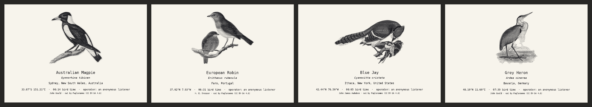

# It's always dawning somewhere

Every morning, as the light reaches them, birds begin to sing. The light keeps moving west, and the song moves with it, like a wave going around the Earth. Somewhere it is always dawn, so the song never ends.

This piece brings that wave into one room. An old Brother FAX-275 follows the sunrise around the planet and plays the birds singing in it, live, through its speaker. After each song it prints the bird: a 19th-century illustration, its name, the place and the hour it sang.



Made for *Time* (ITPG-GT 2040), NYU ITP, Fall 2026 · Sofía Bernasconi

## What's here

- `fax/birdsong_dawn.py` – the piece. Finds birds singing at their own sunrise on BirdWeather, filters the recording to a phone line, plays it on the fax through a USB modem, and sends the fax a page (T.30 / T.4 written in Python).
- `fax/fugleramme_index.json` – which species have an illustration in Fugleramme, and who drew it.
- `p5/` – a browser version to test the piece without the fax.
- `slic/` – Arduino code and a test for a Silvertel Ag1171 SLIC, to make the fax ring and answer by itself (work in progress).
- `experiments/ai_translator/` – an earlier version where an AI "translated" each song into a message. I left it out of the final piece.

## Running it

You need Python 3, `pyserial` and `Pillow` (`pip3 install pyserial pillow`), and `ffmpeg` for some recordings.

```
cd fax
python3 birdsong_dawn.py dawn-preview   # no fax: saves dawn_preview.png
python3 birdsong_dawn.py region dawn    # live, with the modem and the fax
```

Hardware: Brother FAX-275 (thermal paper), StarTech USB56KEMH2 modem, and a DIY phone line (9 V battery and a 330 Ω resistor between two RJ11 breakouts). The fax's Easy Receive has to be on, and for now Hook has to be pressed before each bird.

The browser version: open `p5/dawn_preview.html`, or paste `p5/sketch.js` into the p5.js editor.

## Credits

- Live detections and recordings: [BirdWeather](https://www.birdweather.com) and its station operators
- Species identification: BirdNET (Cornell Lab of Ornithology & TU Chemnitz)
- Illustrations: [Fugleramme](https://github.com/arnegiacomo/fugleramme), CC BY-SA 4.0, cut from public-domain plates by John Gould, the von Wright brothers, John James Audubon and others. The illustrations are downloaded from Fugleramme when the piece runs; `fugleramme_index.json` is derived from its manifest and shared under CC BY-SA 4.0.
- Written with help from Claude (Anthropic)
